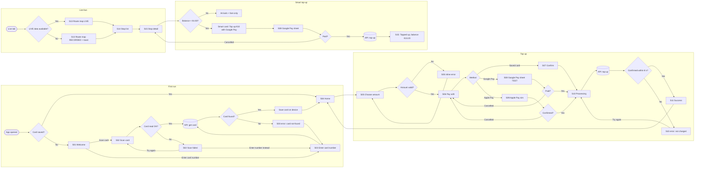

# Flow Diagram with Decision Branches: Leap+

Two ways to get arrows and decision branches in Figma:
1. **FigJam AI** (recommended for a flowchart): open a FigJam board → AI "Generate" → paste Prompt FJ-1.
2. **Figma MCP `generate_diagram`** (if connected): Devin sends the Mermaid code below and the diagram appears in FigJam.
3. **Wireframe frames with arrows:** in Figma Design, add prototype connections between the frames (Prototype tab → drag the blue handle from a button to the target frame). Turn on "Show prototype connections" to see arrows on the canvas.

Shapes: rounded box = screen, diamond = decision, cylinder = our API (Google Sheet), red path = failure branch.

## Prompt FJ-1 — FigJam AI flowchart (paste as-is)

```
Create a left-to-right flowchart titled "Leap+ user flows (concept prototype)". Use rounded rectangles for screens (label = screen ID + name), diamonds for decisions, a cylinder for "Our API (Google Sheet)", green arrows for success paths, red arrows for failure paths. Group into 4 labelled sections.

Section A "First run":
Start: "App opened" → diamond "Card saved?" — Yes → "S04 Home". No → "S01 Welcome".
"S01 Welcome" → diamond "User choice" — "Scan card" → "S02 Scan card"; "Enter card number" → "S03 Enter card number".
"S02 Scan card" → diamond "Card read OK?" — Yes → "Our API: get card"; No (red) → "S02 Scan failed: Try again / Enter number instead". From "S02 Scan failed": "Try again" → "S02 Scan card"; "Enter number instead" → "S03 Enter card number".
"S03 Enter card number" → "Our API: get card".
"Our API: get card" → diamond "Card found?" — Yes → "Save card on device" → "S04 Home". No (red) → "S03 error: We could not find this card" → back to "S03 Enter card number".

Section B "Top up":
"S04 Home" → "S05 Choose amount" → diamond "Amount valid? (min €5, balance ≤ €150)" — No (red) → "S05 inline error" → back to "S05 Choose amount". Yes → "S06 Pay with".
"S06 Pay with" → diamond "Payment method" — "Saved card" → "S07 Confirm" → "S10 Processing"; "Google Pay" → "S08 Google Pay sheet (TEST)"; "Apple Pay" → "S09 Apple Pay sheet (simulated)".
"S08 Google Pay sheet" → diamond "Paid?" — Yes → "S10 Processing"; Cancelled (red) → back to "S06 Pay with".
"S09 Apple Pay sheet" → diamond "Confirmed?" — Yes → "S10 Processing"; Cancelled (red) → back to "S06 Pay with".
"S10 Processing" → "Our API: top up" → diamond "Confirmed within 8 s?" — Yes → "S11 Success" → "S04 Home (new balance)". No (red) → "S10 error: Not confirmed. You were not charged" → "Try again" → "S10 Processing".

Section C "Live bus":
"Live tab" → diamond "LIVE data available?" — Yes → "S13 Route map (LIVE)"; No (red) → "S13 Route map (RECORDED) + toast".
"S13 Route map" → "S14 Stop list" → "S15 Stop detail".

Section D "Smart top-up (wow)":
"S15 Stop detail" → diamond "Balance < €4.00?" — No → "Show arrivals + fare only". Yes → "Smart top-up card: Top up €10 with Google Pay" → "S08 Google Pay sheet" → diamond "Paid?" — Yes → "Our API: top up" → "S15: Topped up. Balance €13.20"; Cancelled (red) → back to "S15 Stop detail".
```

## Mermaid source (same flow; for Figma MCP or any Mermaid viewer)


